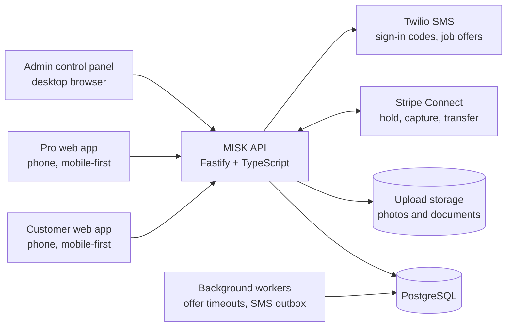
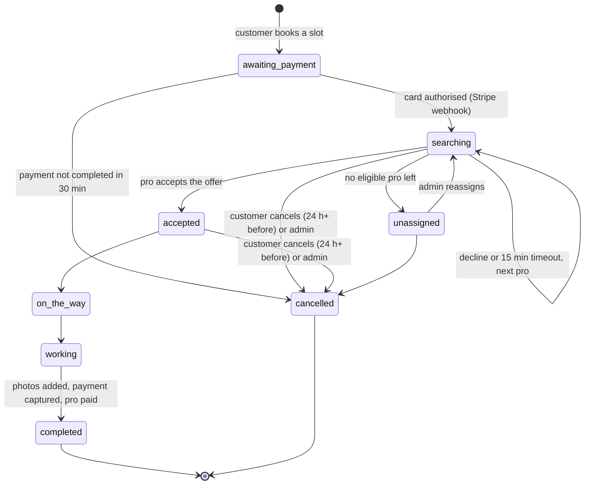
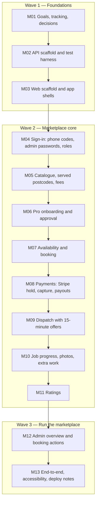
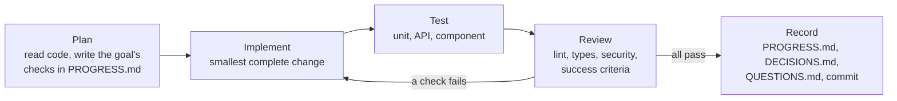

# MISK — Goals and Loop Protocol

MISK is a marketplace for home and garden services. Customers book a verified pro for a one-off job at a
fixed, upfront price. Pros (craftsmen and gardeners) apply, get approved, and accept nearby jobs. The MISK
team runs the marketplace from a web control panel. The product reference is `docs/product-demo.html`.

This file is the work queue. Work only on goals whose status in `PROGRESS.md` is `open`, in order.

## Phase 1 success criteria

Phase 1 ("launch in one city", from the demo's roadmap) is done when all of these hold:

1. A customer can sign in with a phone code, pick a service and size, enter an address in a served
   postcode, choose a slot that really has a free pro, pay by card (held, not taken), and follow the job.
2. The job is offered to the best-rated free pro who covers that postcode. The pro has 15 minutes to
   accept; on decline or timeout it moves to the next pro automatically.
3. The pro walks the job through accepted → on the way → working → done, with photos. Done captures the
   held payment and transfers the pro's share to their Stripe account.
4. The pro can ask for extra work at a fixed price; nothing extra is charged unless the customer approves.
5. The customer rates the pro; ratings decide who is offered jobs first.
6. A person can apply as a pro in the app (trades, documents, travel distance, working days) and gets no
   job until an admin approves them.
7. Admins see bookings, revenue and ratings, approve pros, manage the catalogue, served postcodes and
   fees, and can reassign or cancel and refund a booking.
8. Every goal's tests pass: backend unit and API tests on a real PostgreSQL, web component tests, and a
   browser end-to-end test of the booking flow. Lint and type checks pass with zero warnings.
9. No secret is in the repository. Every unknown requirement is recorded in `QUESTIONS.md` with the
   default that was built, never guessed silently.

Later phases (monthly plans, native apps, chat, live location, growth) get their own goals after the
Phase 1 gate passes.

## Architecture

## Booking lifecycle

## Goals and dependencies

## The loop — run it for every goal

1. **Plan.** Re-read the goal, the code it touches, and `QUESTIONS.md`. List the checks that prove it.
2. **Implement.** Production code only: validated input, translated error codes, no stubs or TODOs.
3. **Test.** Add tests for the behaviour and the failure paths. Run the whole suite, not just new tests.
4. **Review.** `npm run lint`, `npm run typecheck`/`build`, and `npm test` in each package must pass.
   Check access rules: every route says who may call it, and a user only ever sees their own data.
5. **Record.** Mark the goal in `PROGRESS.md`, log design choices in `DECISIONS.md`, park unknowns in
   `QUESTIONS.md` with the default built, then commit with the goal id in the message.

## Goal details

### M01 Goals, tracking, decisions
This file, `PROGRESS.md`, `DECISIONS.md`, `QUESTIONS.md`, `README.md`. Check: documents exist and agree.

### M02 API scaffold and test harness
Fastify app with strict validation, translated error codes, origin check on writes, `/health`, config
loaded and validated from the environment, migrations, embedded PostgreSQL for tests and local
development. Check: health and config tests pass on a real database.

### M03 Web scaffold and app shells
React + Vite + React Router app with three areas: customer (`/`), pro (`/pro`), admin (`/admin`).
Mobile-first customer and pro layouts, desktop admin layout, error boundary, API client. Check: lint,
build and component tests pass.

### M04 Sign-in
Customers and pros sign in with a 6-digit SMS code (rate-limited, hashed, expiring, attempt-limited) and
choose their role on first sign-in. Admins sign in with username and password; the first admin is
created from the command line. Sessions are random tokens in an HTTP-only cookie, stored hashed.
Check: API tests for every path, including lockouts and role guards.

### M05 Catalogue, served postcodes, fees
Admins manage categories, services (price, duration, size multipliers), served postcodes with
coordinates, the service fee and the pros' share. Customers read the active catalogue. Check: API and
page tests; prices stored as integer cents.

### M06 Pro onboarding and approval
Pros apply with trades, three documents (ID, trade certificate, liability insurance), home postcode,
travel distance and working days. Admins review documents and approve or reject. Only approved pros
are offered jobs. Check: upload limits and types enforced, documents readable only by the pro and admins.

### M07 Availability and booking
Slots every two hours from 08:00 to 18:00, for the next 6 days. A slot is free when an approved pro with
that trade covers the postcode, works that day, and has no overlapping job. Booking stores a price
snapshot. Check: availability and double-booking tests.

### M08 Payments
Stripe PaymentIntent with manual capture, saved for later off-session use. A signed webhook confirms the
hold. Pros onboard to Stripe Connect Express with weekly Friday payouts. Completion captures and transfers
the pro's share. Cancellation releases the hold. Check: gateway contract tests with a fake, webhook
signature tests.

### M09 Dispatch
Offer to the highest-rated eligible free pro, 15 minutes to accept, then the next one. With nobody left the
booking becomes unassigned for the admins. Check: ordering, timeout and race tests.

### M10 Job progress, photos, extra work
Pro moves the job through its steps, uploads completion photos, and can request extra work; the customer
approves (card charged on hold) or declines. Customer sees the live timeline. Check: transition rules.

### M11 Ratings
1–5 stars and tags after completion, once per booking. Average rating drives dispatch order.

### M12 Admin overview and booking actions
KPIs for today, 7 and 30 days, booking list with filters, reassign, cancel with refund.

### M13 End-to-end, accessibility, deploy notes
Playwright run of the whole booking flow against the real API with the fake payment gateway, axe checks
on every page, and a deployment section in the README.
