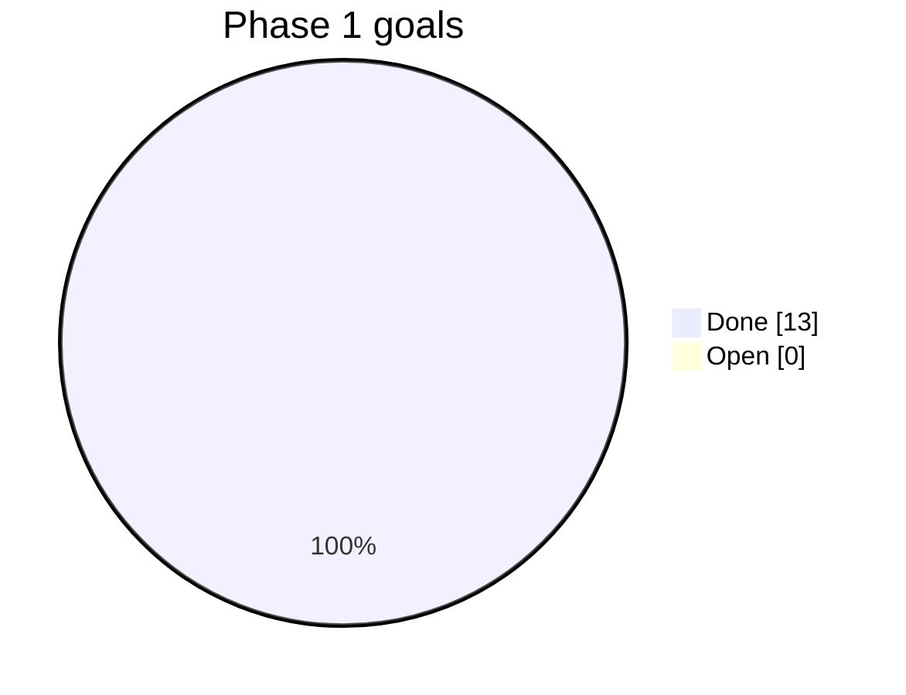

# Progress

Status of every goal in `GOALS.md`: `done`, `open`, or `blocked`.

| Goal | Title                                   | Status |
| ---- | --------------------------------------- | ------ |
| M01  | Goals, tracking, decisions              | done   |
| M02  | API scaffold and test harness           | done   |
| M03  | Web scaffold and app shells             | done   |
| M04  | Sign-in                                 | done   |
| M05  | Catalogue, served postcodes, fees       | done   |
| M06  | Pro onboarding and approval             | done   |
| M07  | Availability and booking                | done   |
| M08  | Payments                                | done   |
| M09  | Dispatch                                | done   |
| M10  | Job progress, photos, extra work        | done   |
| M11  | Ratings                                 | done   |
| M12  | Admin overview and booking actions      | done   |
| M13  | End-to-end, accessibility, deploy notes | done   |

Phase 1 gate: all checks in the README pass. Live Stripe and Twilio accounts are not tested by the
automated suite; the first real-money run is part of the launch checklist.

## Loop log

| Date | Goal | Loops | Result |
| ---- | ---- | ----- | ------ |
| 2026-11-04 | M01 | 1 | Goals, graphs, decisions D1–D12, questions Q1–Q9 written. |
| 2026-11-04 | M02, M04–M12 | 4 | API built. Loop 2: Postgres could not type a `CASE` parameter in session expiry; cast added. Loop 3: lint banned non-null assertions; `onlyRow` helper added. Loop 4: fake payment state leaked between tests; reset added. 63 API tests pass. |
| 2026-11-04 | M03 | 2 | Web app built. Loop 2: typed translation keys caught two untyped status lookups; ARIA lint mistook a `role` prop; both fixed. 18 component tests pass. |
| 2026-11-04 | M13 | 6 | Browser story: customer books and pays, pro accepts, asks for extra work, adds a photo, completes; customer approves and rates; admin sees the money. axe checks on every screen. Fixed along the way: two real accessibility faults (low-contrast weekday label, `aria-label` on a plain `span` for star ratings) and three ambiguous test locators. 4 of 4 stories pass. |
| 2026-11-04 | Admin menu, plan builder | 1 | Menu now matches the design: Overview, Bookings, Providers, Plans, Catalogue, Settings. Areas and Team moved into Settings; sign-out to a top bar. Plan builder (Phase 2 first step) with live preview, drafts and publishing. |

## Next

Phase 2 continues with customer subscriptions, automatic visit planning, skip and pause (the plan builder
is done). They get their own goals in `GOALS.md` once the owner has answered the launch questions in `QUESTIONS.md`.
