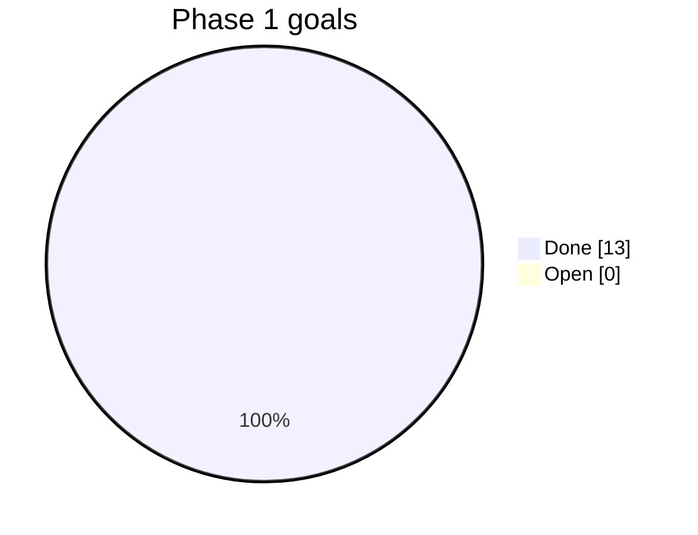

# Progress

Status of every goal in `GOALS.md`: `done`, `open`, or `blocked`.

| Goal | Title                                   | Status |
| ---- | --------------------------------------- | ------ |
| M01  | Goals, tracking, decisions              | done   |
| M02  | API scaffold and test harness           | done   |
| M03  | Web scaffold and app shells             | done   |
| M04  | Sign-in                                 | done   |
| M05  | Catalogue, served postcodes, fees       | done   |
| M06  | Pro onboarding and approval             | done   |
| M07  | Availability and booking                | done   |
| M08  | Payments                                | done   |
| M09  | Dispatch                                | done   |
| M10  | Job progress, photos, extra work        | done   |
| M11  | Ratings                                 | done   |
| M12  | Admin overview and booking actions      | done   |
| M13  | End-to-end, accessibility, deploy notes | done   |

Phase 1 gate: all checks in the README pass. Live Stripe and Twilio accounts are not tested by the
automated suite; the first real-money run is part of the launch checklist.

## Loop log

| Date | Goal | Loops | Result |
| ---- | ---- | ----- | ------ |
| 2026-11-04 | M01 | 1 | Goals, graphs, decisions D1–D12, questions Q1–Q9 written. |
| 2026-11-04 | M02, M04–M12 | 4 | API built. Loop 2: Postgres could not type a `CASE` parameter in session expiry; cast added. Loop 3: lint banned non-null assertions; `onlyRow` helper added. Loop 4: fake payment state leaked between tests; reset added. 63 API tests pass. |
| 2026-11-04 | M03 | 2 | Web app built. Loop 2: typed translation keys caught two untyped status lookups; ARIA lint mistook a `role` prop; both fixed. 18 component tests pass. |
| 2026-11-04 | M13 | 6 | Browser story: customer books and pays, pro accepts, asks for extra work, adds a photo, completes; customer approves and rates; admin sees the money. axe checks on every screen. Fixed along the way: two real accessibility faults (low-contrast weekday label, `aria-label` on a plain `span` for star ratings) and three ambiguous test locators. 4 of 4 stories pass. |
| 2026-11-04 | Admin menu, plan builder | 1 | Menu now matches the design: Overview, Bookings, Providers, Plans, Catalogue, Settings. Areas and Team moved into Settings; sign-out to a top bar. Plan builder (Phase 2 first step) with live preview, drafts and publishing. |

| 2026-11-06 | Admin bookings page | 4 | Bookings and plan visits in one list with tabs and counts, search, trade and type filters, CSV export; side panel (×, Esc, click outside) with progress, money split, assign, move, cancel, refund, charge after a problem, and an action log. Customers are charged 24 hours after the job and can report a problem first (D25, D26). Loop 2: the old tests expected an immediate charge; they now move the clock a day. Loop 3: a moved booking lost its "Moved" message because the form was keyed by the start time. Loop 4: axe found `role="dialog"` on an `<aside>`; now a `
`. 142 API, 74 web and 7 browser tests pass. |
| 2026-11-09 | Providers page | 4 | Key numbers, four tabs with counts, red menu badge, invite link; application review with four checks, approve / ask for more / reject; active pros' 30-day numbers with red values and warning icons; side panel with documents, payouts (bank last 4 digits, next payout), reviews and log; watch list, coaching call, pause, suspend with hand-over, reinstate; automatic Pending approval when a document runs out (D27–D30). Loop 2: plan test body lacked the optional-extra fields. Loop 3: user-event replaces the clipboard, so the invite test reads it back. Loop 4: axe found the red badge text 1% short of contrast; darkened. 160 API, 87 web and 7 browser tests pass. |
| 2026-11-09 | Catalogue page | 2 | Trades with visible services and pros; selected trade's verified pros; service table with base price edited in place (sizes and earnings update while typing, saved on leave or Enter), per-hour services, visible switch with faded hidden rows, Add service row with Cancel, size guide with ×1.0/×1.3/×1.7 and example prices, "See in the app" preview, new trades as drafts, publish / back to draft, activity log (D31, D32). Customer app: "New" badge, per-hour prices, no sizes for hourly services, catalogue refreshed every 30 s. Loop 2: a lint rule flagged resetting the price field from an effect; the field now restarts by key when a new price arrives. 166 API, 98 web and 7 browser tests pass. |
| 2026-11-09 | Settings page | 5 | Four tabs that save by themselves with "All changes saved": fees and commission (10–30%) for new bookings, payout frequency synced to Stripe (MISK runs two-weekly payouts), late cancellations charged in full and split, tips split by commission; service zones on a map with go live / pause and a customer waitlist; push, SMS and email per message with tests to the admin's own phone, evening reminders, rating requests and payout messages; team roles enforced on every admin request, invites, and one activity log (D33–D37). Loop 2: the test reset kept settings between tests. Loop 3: "Payout sent" had no SMS by default, so phone-only pros got nothing. Loop 4: a formatter run without a config switched four files to double quotes; a config now keeps the house style. Loop 5: one browser run froze for 45 minutes and did not repeat; Playwright now has hard time limits. 182 API, 112 web and 7 browser tests pass. |
| 2026-11-09 | Bug sweep and demo data | 3 | Crawled every page and tab of the control panel and both apps as admin, customer and pro (console errors, failed requests, broken text, axe), and ran the main actions of every page through the API, including each team role's access. Found and fixed: two red-on-pink texts in the pro panel below contrast, and the preview sending real emails to demo customers' made-up addresses (now only the team's own emails are sent). Demo data now fills every section: waitlist zones and people waiting, a team member per role with a shared demo password, weeks of activity, tips, a reported problem, a job charged tomorrow and a late cancellation. 183 API, 112 web and 7 browser tests pass. |

## Next

Phase 2 continues with customer subscriptions, automatic visit planning, skip and pause (the plan builder
is done). They get their own goals in `GOALS.md` once the owner has answered the launch questions in `QUESTIONS.md`.
