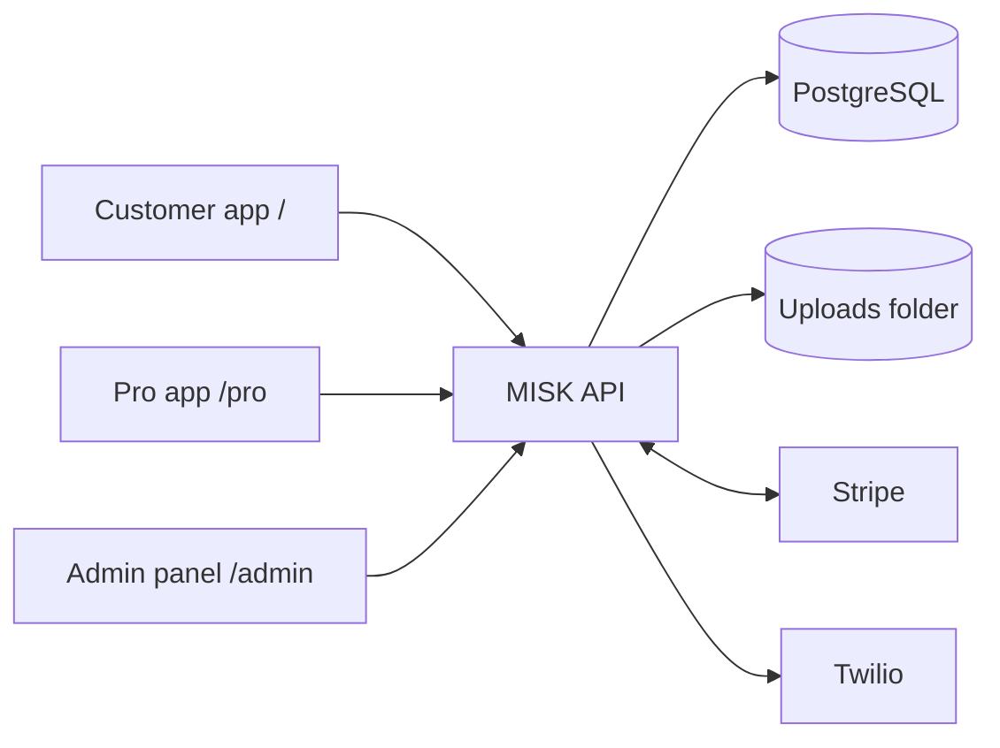
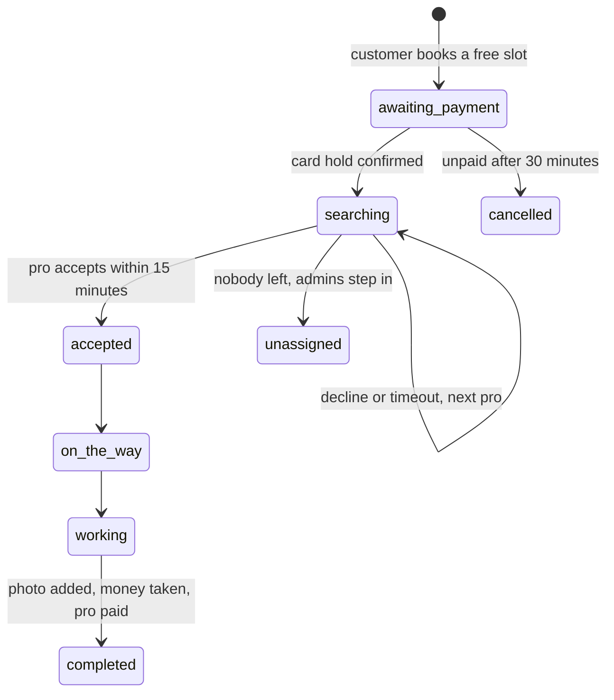

# MISK — Home and garden help, booked in minutes

MISK is a marketplace for home and garden services. Customers book a verified pro for a one-off job
at a fixed price; pros apply, get approved and accept nearby jobs; the MISK team runs everything from
a web control panel. The product reference is `docs/product-demo.html`; the work queue is `GOALS.md`.

| Folder     | Contents                                                        |
| ---------- | --------------------------------------------------------------- |
| `backend/` | API: Fastify, PostgreSQL, Stripe Connect, Twilio                |
| `web/`     | One web app with three areas: customer `/`, pro `/pro`, admin `/admin` |

Both need Node 24 or newer (`.nvmrc`).



## Run it locally

You need a free [Stripe](https://dashboard.stripe.com/register) account for its **test** keys; no
real money moves with them. Twilio is optional locally: without it, sign-in codes appear in the API log.

```
# Terminal 1: database (PostgreSQL comes with the dev dependencies)
cd backend
npm ci
cp .env.example .env        # then add your Stripe test keys
npm run db:dev

# Terminal 2: API on http://localhost:3000
cd backend
npm run migrate
npm run user:create-first-admin
npm run dev

# Terminal 3: Stripe webhooks to your machine (Stripe CLI); put the printed whsec_ secret in backend/.env
stripe listen --forward-to localhost:3000/payments/webhook

# Terminal 4: web app on http://localhost:5173
cd web
npm ci
cp .env.example .env
npm run dev
```

Then, as admin at `/admin/login`: add served postcodes under **Areas**, and categories and services
under **Catalogue**. Sign up a pro at `/signin`, approve them under **Pros**, and have them set up payouts
(Stripe test onboarding accepts test bank details). Customers can book once a pro covers their postcode.
Pay with Stripe's test card `4242 4242 4242 4242`.

## Checks

| Where      | Command              | What it checks                                                  |
| ---------- | -------------------- | --------------------------------------------------------------- |
| `backend/` | `npm run typecheck`  | TypeScript                                                      |
| `backend/` | `npm run lint`       | ESLint, zero warnings                                           |
| `backend/` | `npm test`           | API and unit tests on a real, throwaway PostgreSQL              |
| `web/`     | `npm run lint`       | ESLint with accessibility rules and no hardcoded text           |
| `web/`     | `npm run build`      | Type check and production build                                 |
| `web/`     | `npm test`           | Component and unit tests                                        |
| `web/`     | `npm run test:e2e`   | The whole marketplace in a browser against the real API, with axe accessibility checks |

`npm run test:e2e` needs `npm ci` in `backend/` and `npx playwright install chromium` first. It uses a
fake payment provider and fake text messages that live in `backend/test/`; the real server refuses to
start without Stripe.

## How a booking works



- **Slots** start every two hours from 08:00 to 18:00 for today and the next five days, in
  `MARKET_TIMEZONE`, and only when a free, approved pro with payouts set up covers the postcode.
- **Money** is held on the card at booking and taken at completion. The pro's share (82% by default) of
  the job and of approved extra work is transferred to their Stripe account, paid out every Friday.
  The service fee (€2.90 by default) stays with MISK. Both are set under **Settings**.
- **Extra work** is charged only after the customer approves it in the app.
- **Cancelling** is free until a pro is assigned and then until 24 hours before; after that only admins
  can cancel. Admins can also refund a finished job, which takes the pro's payout back.

## Configuration

Every setting is documented in `backend/.env.example` and `web/.env.example`. Secrets go in `.env`
files, which git ignores.

### Stripe

1. Use test keys (`sk_test_…`, `pk_test_…`) everywhere except production. Live keys are refused unless
   `NODE_ENV=production`.
2. Enable **Connect** in the Stripe dashboard, with Express accounts.
3. Add a webhook endpoint for `https://<api host>/payments/webhook` listening to
   `payment_intent.amount_capturable_updated` and `payment_intent.payment_failed`, and put its signing
   secret in `STRIPE_WEBHOOK_SECRET`.

### Twilio

Set `TWILIO_ACCOUNT_SID`, `TWILIO_AUTH_TOKEN` and `TWILIO_FROM_NUMBER` (international format). Required
in production; sign-in is impossible without it.

## Deploying

1. Build: `npm ci && npm run build` in both folders. The API runs with `npm start` (`node dist/server.js`);
   `web/dist` is static files for any web host or CDN, with every unknown path served `index.html`.
2. Serve the API and web app over HTTPS on the same site (for example `api.misk.app` and `misk.app`),
   so the session cookie works. Set `WEB_ORIGIN` to the web app's exact origin and `NODE_ENV=production`.
3. Behind a reverse proxy, set `TRUST_PROXY=true` so rate limits see real client addresses.
4. Run `npm run migrate` before each release, and `npm run user:create-first-admin` once. Further admins
   are added under **Team** in the control panel.
   - **Forgotten admin password:** "Forgot password?" on the admin sign-in emails a single-use link, valid
     for 30 minutes, to the admin's recovery email (set under **Team**). This needs the SMTP settings in
     `backend/.env`. Without an email on the account, another admin sets a new password under **Team**, or
     run `npm run user:reset-password` on the server.
5. `UPLOAD_DIR` holds pro documents and job photos: put it on persistent, backed-up storage.
6. Health check: `GET /health` returns 200 when the database is reachable.

## Before launch

These are open owner decisions; see `QUESTIONS.md`.

- [ ] Terms of service and privacy policy published, and `VITE_TERMS_URL` / `VITE_PRIVACY_URL` set (Q7).
- [ ] Pilot city, its time zone and served postcodes (Q2).
- [ ] Pros' share and service fee confirmed (Q4, Q5); cancellation policy within 24 hours (Q3).
- [ ] VAT treatment and invoices checked with an accountant (Q8).
- [ ] Customers' and pros' consent to texts and data storage recorded at sign-up.
- [ ] Stripe account verified for live payments and Connect payouts in the pilot country.
