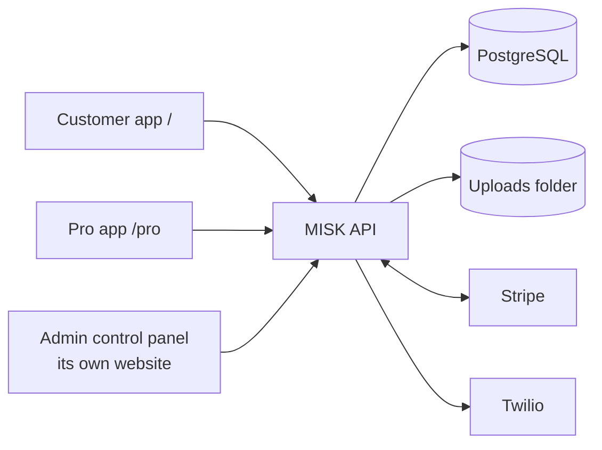
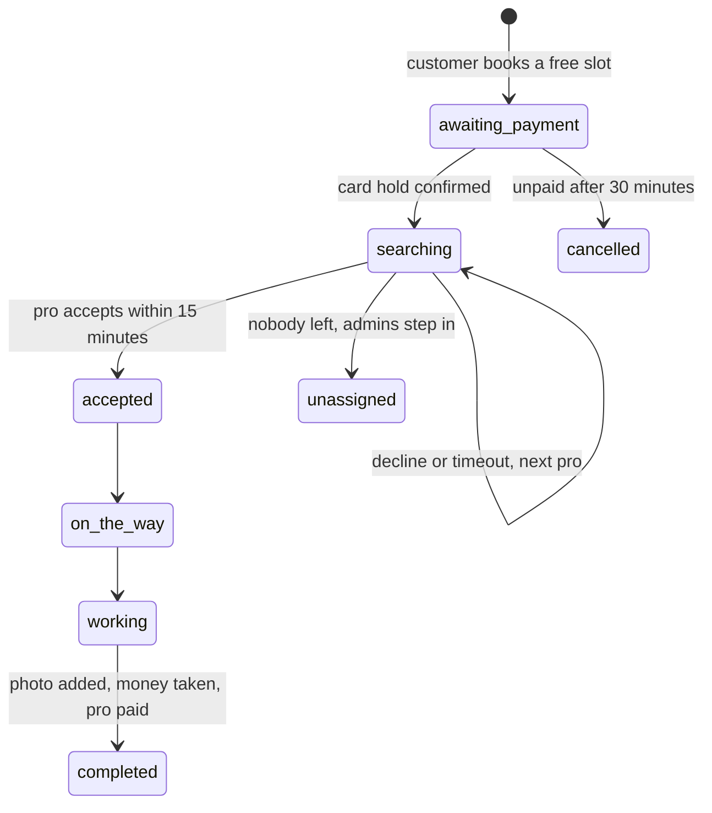

# MISK — Home and garden help, booked in minutes

MISK is a marketplace for home and garden services. Customers book a verified pro for a one-off job
at a fixed price; pros apply, get approved and accept nearby jobs; the MISK team runs everything from
a web control panel. The product reference is `docs/product-demo.html`; the work queue is `GOALS.md`.

| Folder     | Contents                                                        |
| ---------- | --------------------------------------------------------------- |
| `backend/` | API: Fastify, PostgreSQL, Stripe Connect, Twilio                |
| `web/`     | Two websites from one codebase: the customer and pro app (`/`, `/pro`), and the admin control panel (`/admin`), each with its own login |

Both need Node 24 or newer (`.nvmrc`).



## Run it locally

You need a free [Stripe](https://dashboard.stripe.com/register) account for its **test** keys; no
real money moves with them. Twilio is optional locally: without it, sign-in codes appear in the API log.

```
# Terminal 1: database (PostgreSQL comes with the dev dependencies)
cd backend
npm ci
cp .env.example .env        # then add your Stripe test keys
npm run db:dev

# Terminal 2: API on http://localhost:3000
cd backend
npm run migrate
npm run user:create-first-admin
npm run dev

# Terminal 3: Stripe webhooks to your machine (Stripe CLI); put the printed whsec_ secret in backend/.env
stripe listen --forward-to localhost:3000/payments/webhook

# Terminal 4: customer and pro app on http://localhost:5173
cd web
npm ci
cp .env.example .env
npm run dev

# Terminal 5: admin control panel on http://localhost:5174
cd web
npm run dev:admin
```

Then, as admin at http://localhost:5174/admin/login: add served postcodes under **Areas**, and categories and services
under **Catalogue**. Sign up a pro at `/signin`, approve them under **Pros**, and have them set up payouts
(Stripe test onboarding accepts test bank details). Customers can book once a pro covers their postcode.
Pay with Stripe's test card `4242 4242 4242 4242`.

## Demo data

Two ways to work with a full, realistic marketplace without typing data in:

| Command (in `backend/`) | What you get |
| ----------------------- | ------------ |
| `npm run preview:server` | A throwaway API on port 3100 with fake payments, filled with demo data on every start. Run the app with `VITE_API_BASE_URL=http://localhost:3100 npx vite --port 4173` and the control panel with `VITE_API_BASE_URL=http://localhost:3100 npx vite --mode admin --port 4174`. Everything works end to end, including completing, paying and refunding the demo jobs. |
| `npm run db:seed` | Fills your own development database (`npm run db:dev`). Refuses a database that already has users; `npm run db:seed -- --reset` empties it first. Never runs with `NODE_ENV=production`. |

The demo data (`backend/src/seed/demo-data.ts`) is the same every time, with dates relative to today:

- 8 Berlin postcodes, the demo's 6 categories and 18 services, 4 monthly plans (3 live, 1 draft)
- 9 pros: 6 approved with payouts, plus one each submitted (to review), rejected (with a note) and draft, all with documents
- 9 customers: 5 sign in by phone, 4 by email
- About 74 bookings: eight weeks of finished jobs with ratings, photos, extra work, payouts, cancellations and refunds,
  plus one job of each live state today: working, on the way (with extra work waiting for approval), accepted,
  searching (with a 15-minute offer), unassigned and awaiting payment

| Sign in as | Where | With |
| ---------- | ----- | ---- |
| Admin | the control panel's `/admin/login` | `admin` / `demo admin password` |
| Customer by email | `/signin` | `anna@example.com` (or `ben@`, `clara@`, `emil@example.com`) / `garden42` |
| Customer by phone | `/signin?method=phone` | `+4915100000001` (Sara, has a job in progress) |
| Pro by phone | `/signin?method=phone` | `+4915200000001` (Daniel, gardener) |

Phone codes appear in the API log without Twilio; in the preview also at
`http://localhost:3100/test/last-code?phone=%2B4915100000001`. With `db:seed` and real Stripe test keys, seeded bookings carry
made-up payment ids, so do not complete or refund them there; use the preview for that.

## Checks

| Where      | Command              | What it checks                                                  |
| ---------- | -------------------- | --------------------------------------------------------------- |
| `backend/` | `npm run typecheck`  | TypeScript                                                      |
| `backend/` | `npm run lint`       | ESLint, zero warnings                                           |
| `backend/` | `npm test`           | API and unit tests on a real, throwaway PostgreSQL              |
| `web/`     | `npm run lint`       | ESLint with accessibility rules and no hardcoded text           |
| `web/`     | `npm run build`      | Type check and production build                                 |
| `web/`     | `npm test`           | Component and unit tests                                        |
| `web/`     | `npm run test:e2e`   | The whole marketplace in a browser against the real API, with axe accessibility checks |

`npm run test:e2e` needs `npm ci` in `backend/` and `npx playwright install chromium` first. It uses a
fake payment provider and fake text messages that live in `backend/test/`; the real server refuses to
start without Stripe.

## How a booking works



- **Slots** start every two hours from 08:00 to 18:00 for today and the next five days, in
  `MARKET_TIMEZONE`, and only when a free, approved pro with payouts set up covers the postcode.
- **Money** is held on the card at booking and taken at completion. The pro's share (82% by default) of
  the job and of approved extra work is transferred to their Stripe account, paid out every Friday.
  The service fee (€2.90 by default) stays with MISK. Both are set under **Settings**.
- **Extra work** is charged only after the customer approves it in the app.
- **Monthly plans** are built and published by admins. Customers subscribe in the app's Plans tab (size,
  days, morning or afternoon, optional extra), get one regular pro, and pay monthly through Stripe. Visits
  are planned four weeks ahead; customers can skip a limited number a month and cancel after the minimum
  term. Seasonal plans run April to October and are not charged in winter. Pros see the plans in their
  trades and their plan visits, and tick off the tasks on each visit.
- **Cancelling** is free until a pro is assigned and then until 24 hours before; after that only admins
  can cancel. Admins can also refund a finished job, which takes the pro's payout back.

## Configuration

Every setting is documented in `backend/.env.example` and `web/.env.example`. Secrets go in `.env`
files, which git ignores.

### Stripe

1. Use test keys (`sk_test_…`, `pk_test_…`) everywhere except production. Live keys are refused unless
   `NODE_ENV=production`.
2. Enable **Connect** in the Stripe dashboard, with Express accounts.
3. Add a webhook endpoint for `https://<api host>/payments/webhook` listening to
   `payment_intent.amount_capturable_updated`, `payment_intent.payment_failed`, `invoice.paid` and
   `invoice.payment_failed` (the last two bill monthly plans), and put its signing secret in
   `STRIPE_WEBHOOK_SECRET`.

### Twilio

Set `TWILIO_ACCOUNT_SID`, `TWILIO_AUTH_TOKEN` and `TWILIO_FROM_NUMBER` (international format). Required
in production; sign-in is impossible without it.

## Deploying

1. Build: `npm ci && npm run build` in both folders. The API runs with `npm start` (`node dist/server.js`).
   `web/dist` is the customer and pro app and `web/dist-admin` the admin control panel: static files for any
   web host or CDN, each with every unknown path served `index.html`.
2. Serve all three over HTTPS on the same site (for example `api.misk.app`, `misk.app` and `admin.misk.app`),
   so the session cookies work. Set `WEB_ORIGIN` to the app's exact origin, `ADMIN_ORIGIN` to the control
   panel's, and `NODE_ENV=production`. Admins can sign in only on the control panel, everyone else only in
   the app, and each site has its own session.
3. Behind a reverse proxy, set `TRUST_PROXY=true` so rate limits see real client addresses.
4. Run `npm run migrate` before each release, and `npm run user:create-first-admin` once. Further admins
   are added under **Team** in the control panel.
   - **Forgotten admin password:** "Forgot password?" on the admin sign-in emails a single-use link, valid
     for 30 minutes, to the admin's recovery email (set under **Team**). This needs the SMTP settings in
     `backend/.env`. Without an email on the account, another admin sets a new password under **Team**, or
     run `npm run user:reset-password` on the server.
5. `UPLOAD_DIR` holds pro documents and job photos: put it on persistent, backed-up storage.
6. Health check: `GET /health` returns 200 when the database is reachable.

## Before launch

These are open owner decisions; see `QUESTIONS.md`.

- [ ] Terms of service and privacy policy published, and `VITE_TERMS_URL` / `VITE_PRIVACY_URL` set (Q7).
- [ ] Pilot city, its time zone and served postcodes (Q2).
- [ ] Pros' share and service fee confirmed (Q4, Q5); cancellation policy within 24 hours (Q3).
- [ ] VAT treatment and invoices checked with an accountant (Q8).
- [ ] Customers' and pros' consent to texts and data storage recorded at sign-up.
- [ ] Stripe account verified for live payments and Connect payouts in the pilot country.
